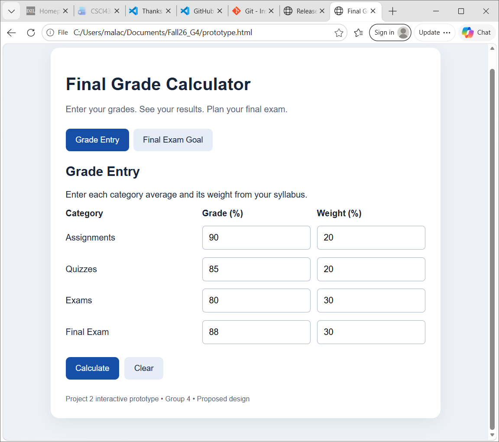
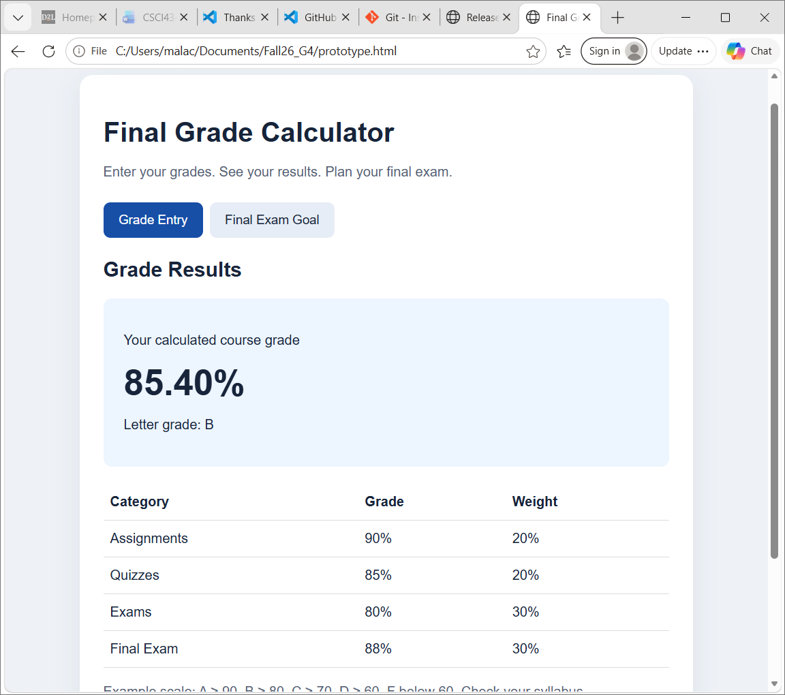
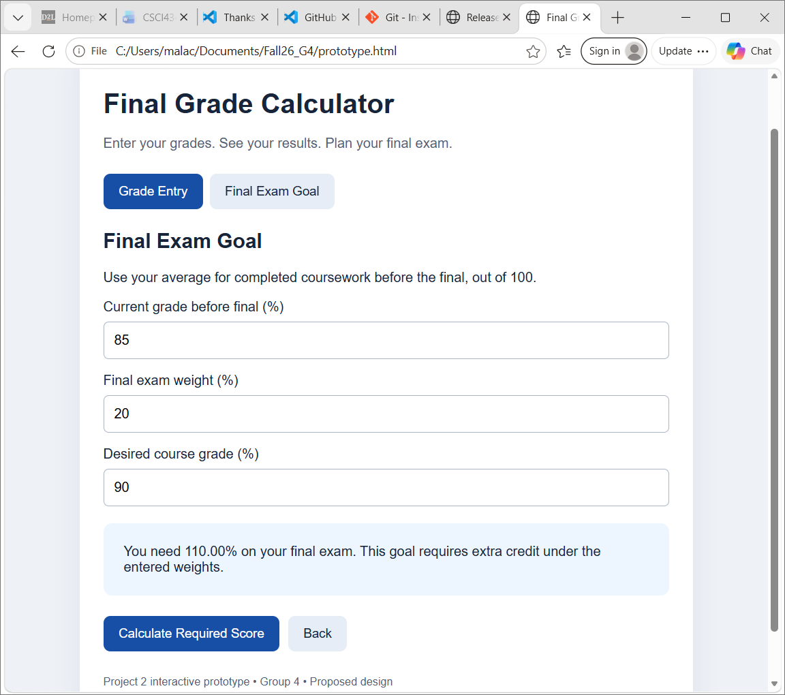

# Final Grade Calculator Prototype Design
Prepared by: Malachi Johnson
Group: 4
Status: Proposed design for team review

## Purpose
The application will help students calculate their course grade
and determine the final exam score needed to reach a desired grade.

## Intended Users
Students who know their course grades and the percentage weights
listed in their syllabus.

## Screen 1: Grade Entry
The main screen will contain grade and weight fields for:
- Assignments
- Quizzes
- Exams
- Final exam

Each grade field represents the average for that category.
A Calculate button will display the results screen.
A Clear button will reset the fields.
A Final Exam Goal button will open the goal calculator.

## Screen 2: Grade Results
This screen will display:
- Final numerical grade
- Corresponding letter grade
- Grade and weight breakdown
- Edit Grades button to return to the entry screen

Example:
Assignments: 90 with a 20% weight
Quizzes: 85 with a 20% weight
Exams: 80 with a 30% weight
Final exam: 88 with a 30% weight

Final grade = (90 × 0.20) + (85 × 0.20)
            + (80 × 0.30) + (88 × 0.30)
            = 85.4%

Proposed letter grade scale:
A: 90–100
B: 80 to below 90
C: 70 to below 80
D: 60 to below 70
F: Below 60

Students should use the grading scale from their course syllabus.
The team will review this proposed scale.

## Screen 3: Final Exam Goal
This screen will contain fields for:
- Current grade before the final exam
- Final exam weight as a percentage
- Desired overall course grade

The current grade is the average for completed coursework,
normalized to a percentage out of 100.

A Calculate Required Score button will display the needed score.
A Back button will return to the grade entry screen.

Required score = (Desired grade - Current grade × (1 - Final weight))
                 / Final weight

The final weight is converted to a decimal for this formula.

Example:
Current grade: 85%
Final exam weight: 20%
Desired course grade: 90%
Required final exam score: 110%

If the required score exceeds 100%, display that the goal cannot
be reached without extra credit under the entered weights.
If the required score is zero or negative, display that a score
of 0% is sufficient to reach the goal.

## Input Validation
- Require all necessary fields.
- Accept only numerical values.
- Accept grades and desired grades from 0 to 100.
- Accept category weights from 0 to 100.
- Require category weights to total 100%.
- Require the final exam goal weight to be greater than 0
  and less than 100%.
- Display a clear error message for invalid entries.

## Prototype Scope
The initial prototype will show the three screens, their buttons,
and how users move between them. Screen images will accompany
this description. The planned application language is Java.

## Proposed Tasks for Team Discussion
- Design the grade entry screen.
- Design the results screen.
- Design the final exam goal screen.
- Review formulas and input validation.
- Review screen navigation and readability.
- Agree on task assignments during the first meeting.

## Prototype Screenshots

### Grade Entry

### Grade Results

### Final Exam Goal
